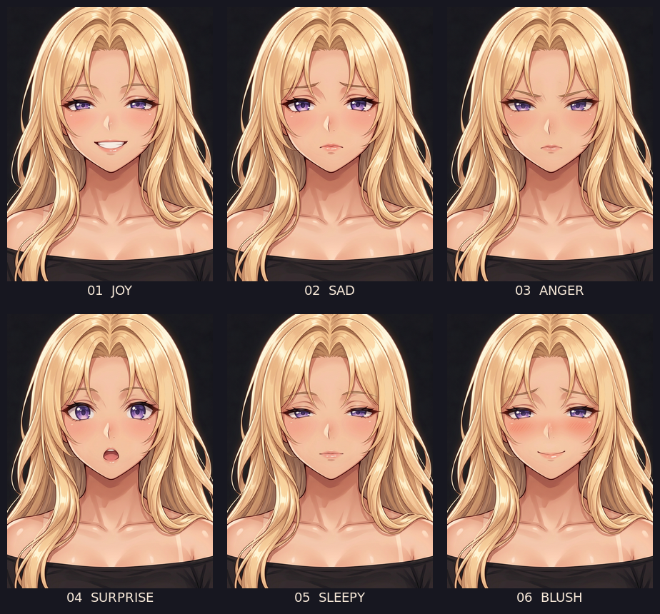

# HERO-01 — эмоции v5, 6/6 APPROVED

| № | Эмоция | Утверждённый PNG 768×1024 | Оценка |
|---|---|---|---|
| 01 | Радость | [HERO-01_emo01_joy.png](../../Approved/HERO-01_emo01_joy.png) | **APPROVE** |
| 02 | Грусть | [HERO-01_emo02_sad.png](../../Approved/HERO-01_emo02_sad.png) | **APPROVE** |
| 03 | Раздражение | [HERO-01_emo03_anger.png](../../Approved/HERO-01_emo03_anger.png) | **APPROVE** |
| 04 | Удивление | [HERO-01_emo04_surprise.png](../../Approved/HERO-01_emo04_surprise.png) | **APPROVE** |
| 05 | Сонливость | [HERO-01_emo05_sleepy.png](../../Approved/HERO-01_emo05_sleepy.png) | **APPROVE** |
| 06 | Смущение | [HERO-01_emo06_blush.png](../../Approved/HERO-01_emo06_blush.png) | **APPROVE** |

Рабочий [шаблон](../emo_set_final/emo02_sad.png) выбран как предположительное соответствие
«approved image 7»; пользователь утвердил результат, но отдельно не подтвердил номер исходного
файла. Кадр и фон сохранены с помощью наложения лицевой области на шаблон; небольшие части
соседних прядей попадают в маску. Исходные генерации находятся в этой папке; исходный
`emo05_sleepy.png` содержит два кадра, а в `ready/` использован единичный retry.

Пользователь утвердил весь сет; шесть файлов в `ready/` побайтно совпадают с копиями в
`Approved/`. Точные промпты, референсы, параметры и постобработка:
[emo_set_v5_template_lock.md](../../../Prompts/emo_set_v5_template_lock.md).
